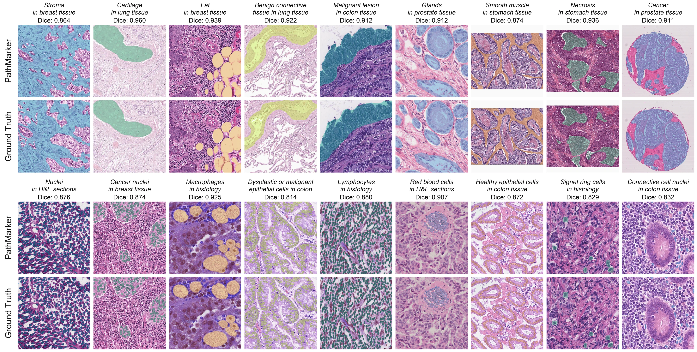

# PathMarker

**A Unified Foundation Model for Quantitative Tumor Profiling and Interpretable Biomarker Discovery**

[](https://huggingface.co/Casperhhh/PathMarker)

[Installation](#installation) · [Segmentation](#segmentation) · [Tumor profiling](#tumor-profiling) · [Clinical prediction and biomarker discovery](#clinical-prediction-and-biomarker-discovery)

## Abstract

Histopathology images capture tissue architecture and cellular organization that reflect tumor biology and clinical outcomes, yet quantifying these patterns at scale remains challenging. Here we present PathMarker, a promptable pathology foundation model pretrained on more than 3.8 million image–concept pairs via hierarchical vision-language alignment. Across 46 datasets, PathMarker achieved mean Dice scores of 0.788 for tissue structures and 0.662 for cellular structures, outperforming existing foundation models by 7.5 and 13.2 percentage points (pp), respectively. Building on PathMarker, we developed a scalable framework that transforms segmentation results into quantitative tumor profiles for clinical prediction and biomarker discovery. Across 17 clinical cohorts involving 8,863 patients with breast, colorectal, thyroid and gastric cancer, the framework identified 167 task-specific biomarkers predictive of ER, PR, HER2, molecular subtype, pathological stage, MSI, BRAF mutation and survival. We further validated the potential of spatial immune biomarkers on survival and adjuvant chemotherapy treatment outcomes. In external cohorts, four spatial immune biomarkers derived from our framework, one for each cancer type, consistently stratified overall survival (C-indices, 0.64–0.70). Notably, among patients with stage III colorectal cancer, adjuvant chemotherapy was linked to prolonged survival in those with low tumour–lymphocyte proximity (interaction P = 0.0082). By grounding clinical outcomes in the measurements of tissue and cellular structures, this study establish PathMarker as a foundation for quantitative tumor profiling and systematic biomarker discovery from routine histology.



## Installation

Use Linux with CUDA-enabled PyTorch and matching torchvision. Install both from the [PyTorch installation selector](https://pytorch.org/get-started/locally/) in the activated environment before running the pip command.

```bash
git clone https://github.com/Casperqian/PathMarker.git
cd PathMarker
conda create -n sam3 python=3.12 -y
conda activate sam3
```

```bash
python -m pip install -e './sam3[train,dev]' einops pillow wandb pytorch-lightning
```

This installs the local package in editable mode, its training and development dependencies, and the additional libraries in the same environment. Whole-slide processing also requires [OpenSlide](https://openslide.org/download/) and its Python bindings. KFB slides require the vendor's `Aslide` reader.

## Segmentation

Set local data paths in [`dataset_paths.py`](sam3/sam3/train/data/dataset_paths.py) and obtain the initialization checkpoint from [SAM 3](https://github.com/facebookresearch/sam3). Review the specific paths and GPU settings in the [launch scripts](sam3/scripts) before running them. From the repository root:

```bash
cd sam3
bash scripts/pretrain.sh       # Image–concept pretraining
bash scripts/finetune.sh       # Tissue semantic segmentation
bash scripts/finetune_inst.sh  # Cell instance segmentation
bash scripts/inference.sh      # Semantic segmentation evaluation
```

## Tumor profiling

Place whole-slide images under `TCGA_ROOT/<COHORT>/`. From the repository root, run tissue and cell segmentation with trained checkpoints, then extract pathomic features.

```bash
export TCGA_ROOT=/path/to/slides COHORT=your_cohort OUTPUT_ROOT=/path/to/features
export TISSUE_CHECKPOINT=/path/to/tissue.pt CELL_CHECKPOINT=/path/to/cell.pt
export CUDA_IDS=0 LIMIT_SLIDES=1

bash biomarker/tme/run_tme_tissue_segment.sh
bash biomarker/tme/run_tme_cell_segment.sh
bash biomarker/tme/run_tme_readout_cpu.sh
```

Set `LIMIT_SLIDES=0` for the full cohort. The pipeline writes per-slide feature tables and a cohort matrix at `OUTPUT_ROOT/<COHORT>/TME_Readout_Matrix.csv`. The [feature schema](biomarker/tme/TME_Readout_Format.csv) lists the measurements.

## Clinical prediction and biomarker discovery

The framework aggregates slide features by case, selects a feature panel on development data, and evaluates the fitted model on a fixed external cohort. Choose a task from the [task configuration](biomarker/downstream/lasso/settings.py). From the repository root:

```bash
export LABEL_ROOT=/path/to/prepared_labels READOUT_ROOT=/path/to/features
export RESULTS_ROOT=/path/to/results PATHMARKER_TASK='task-name'
python -m biomarker.downstream.lasso.run_lasso --tasks "$PATHMARKER_TASK" --workers 1
```

Each task has a predefined external cohort. To select a configuration explicitly, pass `--settings task/external-cohort`. 
## Acknowledgments

We thank the [SAM 3](https://github.com/facebookresearch/sam3) authors for releasing their implementation. [SAM 3 license](sam3/LICENSE)
